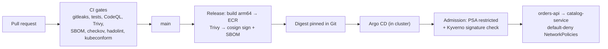

# Secure Delivery to Kubernetes: EKS DevSecOps Pipeline

[](https://github.com/Monkmode-tech/eks-devsecops-pipeline/actions/workflows/ci.yml)
[](https://github.com/Monkmode-tech/eks-devsecops-pipeline/actions/workflows/codeql.yml)


**Roles this project supports:** DevOps Engineer · Cloud Engineer · Security Engineer (application & supply-chain security) · Platform Engineer

## In plain terms (2-minute read)

**The problem.** Software teams ship changes many times a day. Every change is
a chance to ship a bug, a leaked password, or a known security hole in a
third-party component. Recent supply-chain attacks also showed that companies
need to prove that the software *running* is exactly what they *built and approved*.

**What I built.** An automated "assembly line" that takes code from a
developer's change all the way to running on Kubernetes, with **security
checkpoints at every stage**:

- **Before anything merges**, automated checks look for leaked passwords,
  coding flaws, vulnerable components, and insecure configuration. Any
  serious problem stops the line.
- **Every release is digitally signed**, like a tamper-evident seal, and comes
  with an ingredients list (SBOM) of everything inside.
- **The cluster checks the seal at the door.** It refuses software that isn't
  signed by this pipeline, comes from an unapproved source, or tries to run with
  too much power.
- **Deployments happen from Git, not from people or scripts with admin
  access.** If someone changes the live system by hand, it automatically puts
  itself back.
- **Two real microservices** (TypeScript and Java/Spring Boot), each scaling
  automatically and monitored with live dashboards.

**Why it matters to a business**

| Business need | How this project delivers it |
|---------------|------------------------------|
| Ship faster without shipping risk | ~10 automated security and quality gates on every change |
| Prove what is running in production | Signed images, a public transparency log, and an SBOM per release |
| Respond quickly to the next big vulnerability | SBOMs show which images contain the affected component; scans re-run on every release |
| Limit damage if something is compromised | Locked-down containers, deny-by-default networking, CI with no access to the cluster |
| Audit and roll back | Every deployment is a Git commit; rolling back is reverting a commit |
| Keep the lights on | Two replicas per service across data centers, autoscaling, health checks, dashboards |

**What this shows about how I work.** I bring my day job (production
microservices at Verizon, CI/CD, monitoring) together with security
engineering: building security into the delivery process instead of bolting it on.

## Technical summary

- **Services:** `orders-api` (TypeScript on Node.js 24 via native type stripping, **zero runtime dependencies**, hand-rolled Prometheus metrics, timeouts, input limits, security headers) calls `catalog-service` (Spring Boot 4.0, Java 21, Actuator probes + Micrometer)
- **CI gates:** gitleaks, unit tests (14 TS + 5 Java) and `tsc`, CodeQL (security-extended), Trivy image gate on fixable HIGH/CRITICAL, Syft SBOM, hadolint, checkov (Terraform + K8s + Dockerfile + Actions), tflint, kubeconform
- **Release:** GitHub OIDC → ECR (immutable, scan-on-push, KMS) on native arm64 runners → Trivy re-scan → **cosign keyless signing + SPDX SBOM attestation** → digest pinned in Git
- **Platform (Terraform):** EKS 1.36 with access entries, KMS secrets encryption, all control-plane logs, public endpoint restricted to an admin CIDR, `STANDARD` upgrade policy; Graviton managed nodes with IMDSv2 hop limit 1; VPC CNI network policy enforcement; metrics-server; EKS Pod Identity
- **GitOps:** Argo CD app-of-apps (sync waves) deploys Kyverno, policies, kube-prometheus-stack, ServiceMonitors, a Grafana dashboard, and the app
- **Runtime security:** Pod Security Admission `restricted`; Kyverno (ECR-only, no `:latest`, required resources, **verify cosign signature + signer identity**); default-deny NetworkPolicies; non-root, read-only, capability-free containers

## Architecture



More: [architecture](docs/architecture.md) · [pipeline gates](docs/pipeline.md) · [supply chain](docs/supply-chain.md) · [runbook](docs/runbook.md) · [cost](docs/cost.md) · [ADRs](docs/adr)

## Results

> From a live deployment; raw outputs in [`docs/evidence`](docs/evidence).

| Check | Result |
|-------|--------|
| CI gates on every PR | see the CI badge above |
| Unsafe pods rejected at admission (`policy-test.sh`) | _pending first deployment_ |
| Signature verification of deployed images (`cosign verify`) | _pending_ |
| End-to-end order through both services (`smoke-test.sh`) | _pending_ |
| GitOps self-heal after manual drift | _pending_ |

## Quick start

```bash
# Locally, no AWS needed
docker compose up --build
cd services/orders-api && npm test          # Node.js 24

# On AWS (about $0.23/hour; destroy after each session)
cd infra/environments/dev && terraform init -backend-config=backend.hcl && terraform apply
# set the 3 repository variables from `terraform output`, run the release workflow, then:
./scripts/bootstrap-cluster.sh
./scripts/smoke-test.sh && ./scripts/policy-test.sh
```

Full steps: [docs/runbook.md](docs/runbook.md)

## Where to look

| Skill | Evidence |
|---|---|
| CI/CD quality and security gates (tests, typecheck, IaC scan, secrets, image CVEs, SBOM) | [`.github/workflows/ci.yml`](.github/workflows/ci.yml), [docs/pipeline.md](docs/pipeline.md) |
| Software supply-chain security (keyless signing, attestations, SHA-pinned actions) | [`.github/workflows/release.yml`](.github/workflows/release.yml), [docs/supply-chain.md](docs/supply-chain.md), [ADR 0003](docs/adr/0003-keyless-signing-and-admission-verification.md) |
| Fixing vulnerabilities rather than suppressing them (Spring Boot 4 upgrade, npm removed from runtime) | [docs/supply-chain.md](docs/supply-chain.md#minimal-attack-surface-by-design) |
| Kubernetes on EKS with Terraform (access entries, Pod Identity, KMS secrets, IMDSv2) | [`infra/modules/eks`](infra/modules/eks/main.tf) |
| GitOps with Argo CD (pull-based, app-of-apps, sync waves) | [`gitops/`](gitops), [ADR 0002](docs/adr/0002-gitops-pull-based-deploys.md) |
| Policy as code and pod hardening (Kyverno, Pod Security "restricted", NetworkPolicies) | [`gitops/policies`](gitops/policies/kyverno-policies.yaml), [`k8s/base`](k8s/base), [ADR 0004](docs/adr/0004-defense-in-depth-for-pods.md) |
| Observability (Prometheus metrics, ServiceMonitors, Grafana dashboard) | [`gitops/monitoring`](gitops/monitoring) |
| Two languages, production-style services (TypeScript, Java/Spring) | [`services/`](services), [ADR 0001](docs/adr/0001-zero-dependency-typescript-service.md) |
| Operations and cost | [docs/runbook.md](docs/runbook.md), [docs/cost.md](docs/cost.md) |

## Repository layout

```text
services/orders-api/        TypeScript service, tests, Dockerfile
services/catalog-service/   Spring Boot service, tests, multi-stage Dockerfile
infra/                      Terraform: network, EKS, ECR, GitHub OIDC role
k8s/                        Kustomize base (hardened manifests) + dev overlay (pinned digests)
gitops/                     Argo CD apps, Kyverno policies, monitoring config
scripts/                    bootstrap, smoke test, admission policy test
.github/workflows/          ci (gates), release (build/scan/sign/promote), codeql
docs/                       architecture, pipeline, supply chain, runbook, cost, ADRs
```

## Certification alignment

| Exam | Areas exercised |
|------|-----------------|
| AWS DevOps Engineer – Professional | SDLC automation, IaC, monitoring, incident and event response, security and compliance |
| AWS Security – Specialty | Supply-chain integrity, KMS, least-privilege CI identity, EKS security |
| CKA / CKS (Kubernetes) | Workloads, scaling, NetworkPolicy, Pod Security Admission, admission control, image signing |
| HashiCorp Terraform Associate | Modules, providers, state, validation |

## Glossary (for non-technical readers)

| Term | Meaning |
|------|---------|
| Kubernetes / EKS | Software that runs and heals containerized applications; EKS is AWS's managed version |
| Container image | A packaged, ready-to-run copy of an application |
| CI/CD pipeline | The automated assembly line from code change to running software |
| CVE | A publicly known security vulnerability in software |
| SBOM | Software bill of materials: an ingredients list for an application |
| Image signing (cosign) | A tamper-evident seal proving who built an image |
| GitOps / Argo CD | The live system continuously matches what's approved in Git |
| Admission control (Kyverno) | Rules the cluster checks before letting anything run |
| NetworkPolicy | Firewall rules between applications inside the cluster |

## Background

Built by **Caleb Tetteh** (M.S. Cloud Computing Systems, UMGC; B.S. Computer
Science, Georgia Tech; software engineer building Node.js/Java microservices on
AWS at Verizon). It extends the CLCS 615 modernization projects (decomposing a
monolith into EKS-ready microservices, monitoring and auto-scaling strategy) and
the CLCS 605 CI/CD design with a full DevSecOps toolchain.
