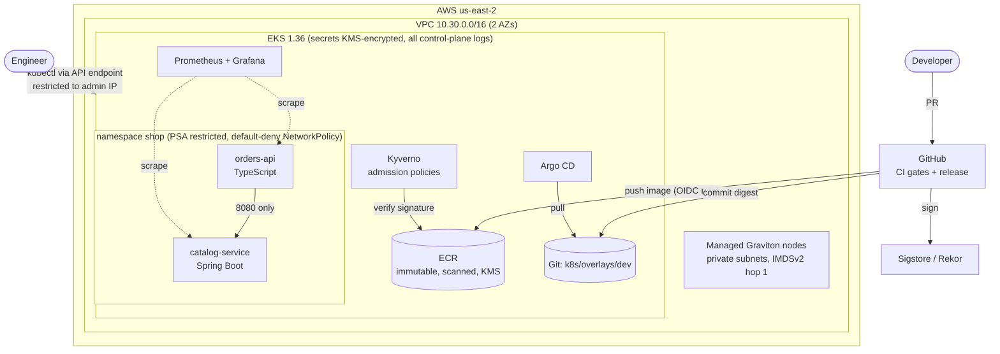

# Architecture

## Components

| Layer | Choice | Why |
|-------|--------|-----|
| Cluster | EKS 1.36, API auth mode (access entries), STANDARD upgrade policy | Current, supported version; no `aws-auth` ConfigMap; no surprise extended-support charges |
| Nodes | Managed node group, AL2023 ARM64 (t4g.medium) | Graviton price/performance; AWS-managed patching of the AMI |
| Networking | VPC CNI with network policy agent | Pods get VPC IPs; Kubernetes NetworkPolicies are enforced natively |
| Secrets | KMS envelope encryption | Secrets in etcd are encrypted with a key the account controls |
| Registry | ECR, immutable tags, scan on push, KMS | Images can't be silently replaced |
| Delivery | GitHub Actions to ECR, Argo CD from Git | CI has no cluster access (pull-based GitOps) |
| Policy | Pod Security Admission `restricted` + Kyverno | Built-in baseline plus supply-chain rules |
| Observability | kube-prometheus-stack, ServiceMonitors, Grafana dashboard | Golden signals for both services |
| Identity | EKS Pod Identity (Kyverno → ECR read) | No long-lived credentials inside the cluster |

## Request flow

`POST /orders` → orders-api validates input (size limit, schema) → calls
`catalog-service:8080/products/{id}` with a 2-second timeout → computes the total
from integer cents → 201. If the catalog is slow or down, orders-api returns
**502 quickly** instead of hanging, and the error rate shows on the dashboard.

## Availability

- Two replicas minimum per service, spread across AZs; HPA scales on CPU.
- PodDisruptionBudgets keep one replica up during node upgrades.
- Rolling updates with `maxUnavailable: 0`; graceful shutdown on SIGTERM in both services.
- The JVM gets a `startupProbe`, so slow starts aren't killed by liveness checks.
