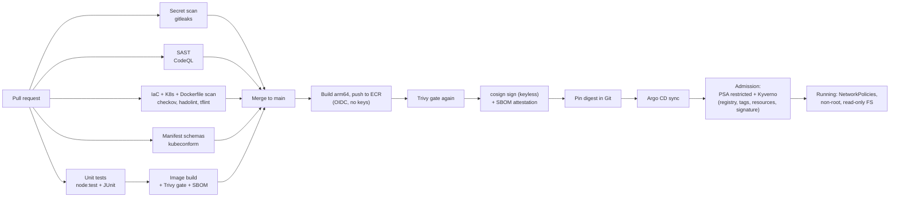

# The secure delivery pipeline

Security is checked at every stage a change passes through, so problems are
caught where they are cheapest to fix: in the pull request.

## Gates

| Stage | Tool | What it stops | Fails the build when |
|-------|------|---------------|----------------------|
| Pre-merge | gitleaks | Committed credentials | Any secret pattern in the full git history |
| Pre-merge | Unit tests | Regressions | Any test fails (14 TypeScript, 5 Java) |
| Pre-merge | `tsc --noEmit` | Type errors | Any type error |
| Pre-merge | CodeQL (security-extended) | Injection, unsafe deserialization, path traversal, etc. | Findings appear in the Security tab and on the PR |
| Pre-merge | Trivy | Vulnerable OS packages and libraries in the image | A fixable HIGH or CRITICAL CVE |
| Pre-merge | Syft (anchore/sbom-action) | Unknown contents | Never; produces the SBOM artifact |
| Pre-merge | hadolint | Dockerfile anti-patterns | Any warning |
| Pre-merge | checkov | Insecure Terraform, Kubernetes, Dockerfiles and workflows | Any failed check not justified inline |
| Pre-merge | tflint, terraform validate | Broken or sloppy IaC | Any error |
| Pre-merge | kubeconform | Invalid manifests | Schema violation |
| Release | Trivy (pushed image) | CVEs published since the PR ran | A fixable HIGH or CRITICAL CVE |
| Release | cosign | Tampered or unofficial images | Signing fails |
| Deploy | Argo CD | Configuration drift | Self-heals drift back to Git |
| Admission | Pod Security Admission (restricted) | Root, privileged, capability-adding pods | Pod violates the restricted profile |
| Admission | Kyverno | Untrusted registries, `:latest`, missing limits, unsigned images | Policy violation (signature policy starts in Audit) |
| Runtime | NetworkPolicies (VPC CNI) | Lateral movement | Any flow not explicitly allowed |

## Why deployment is pull-based (GitOps)

CI never has cluster credentials. It can only push images to two ECR
repositories and commit a digest to Git. Argo CD, running inside the cluster,
pulls the change. A compromised pipeline therefore cannot run arbitrary
workloads, and every deployment is a reviewed, revertible Git commit. See
[ADR 0002](adr/0002-gitops-pull-based-deploys.md).
